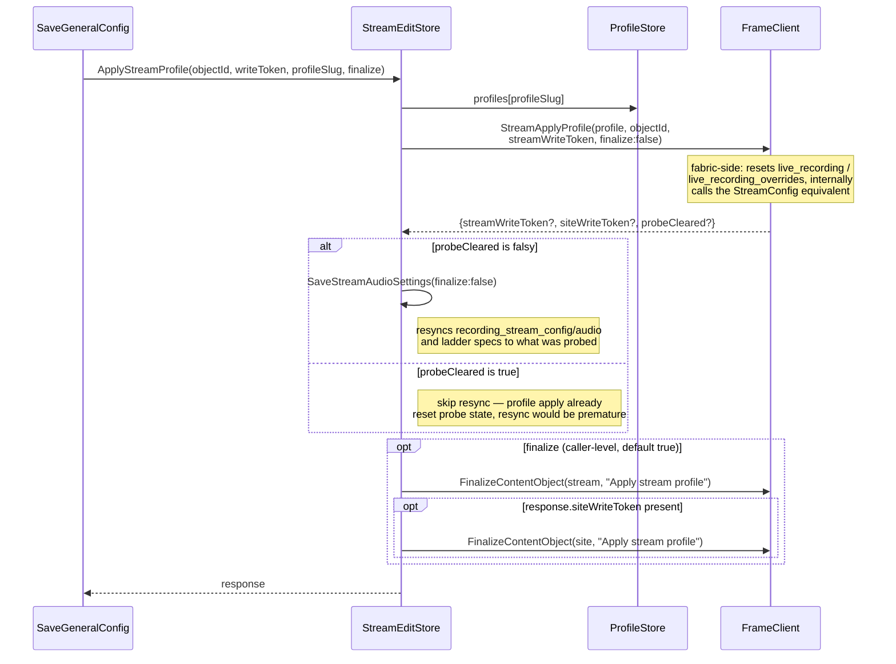
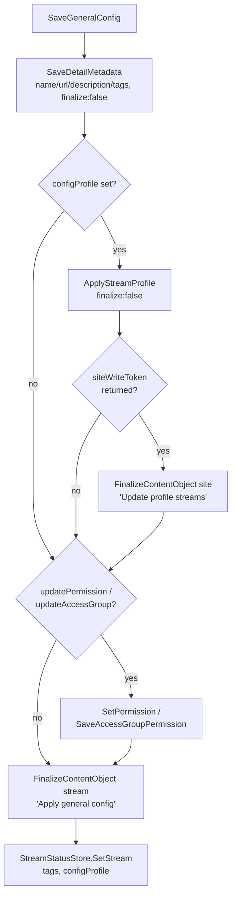

# Profile apply flow

Applying a profile to a stream is driven by `StreamEditStore.ApplyStreamProfile`, almost always via `SaveGeneralConfig` (the General panel's Save path). The key branch is `probeCleared`, returned by the fabric-js `StreamApplyProfile` call, which decides whether the client needs to resync audio settings.

## `ApplyStreamProfile`

## Caller: `SaveGeneralConfig` (General panel Save)

`ApplyStreamProfile` is called with `finalize: false` here, so the outer method controls the single combined commit.

`probeCleared` only drives the audio-resync branch inside `ApplyStreamProfile`; `SaveGeneralConfig` doesn't surface it, so the UI shows no signal when a profile apply clears probe data.

## `ProfileStore` — where profiles come from

- `LoadProfiles()` — `client.StreamConfigProfiles({resolveLinks: true})` populates `profiles` (slug → profile, read-only "original") and seeds `drafts` (editable copies) as a shallow copy.
- `SaveProfiles()` writes each dirty draft via `client.StreamSaveConfigProfile`. On rename, it also migrates `public/asset_metadata/profile_streams/<oldSlug>` → `<newSlug>` on the site object — this is the `stream_profiles` mapping referenced in CLAUDE.md, and it must move atomically with the profile rename.
- `DeleteProfile(slug)` deletes both the `live_stream_profiles/<slug>.json` file and the `public/asset_metadata/profiles/<slug>` metadata.

`ApplyStreamProfile`'s `siteWriteToken` finalize step corresponds to `StreamApplyProfile` itself updating this same site-object profile↔stream bookkeeping fabric-side.

## Key files

- `src/stores/streams/StreamEditStore.ts` — `ApplyStreamProfile`
- `src/stores/streams/StreamEditStore.ts` — `SaveGeneralConfig` (primary caller)
- `src/stores/streams/StreamEditStore.ts` — `SaveStreamAudioSettings` fallback branch (reconstructs audio index from ladder specs when no probe data exists yet)
- `src/pages/streams/details/general/GeneralPanel.jsx` — `Save()`, which calls `SaveGeneralConfig`
- `src/stores/ProfileStore.ts` — `LoadProfiles`
- `src/stores/ProfileStore.ts` — `SaveProfiles` (includes rename migration of `profile_streams`)
- `src/stores/ProfileStore.ts` — `DeleteProfile`