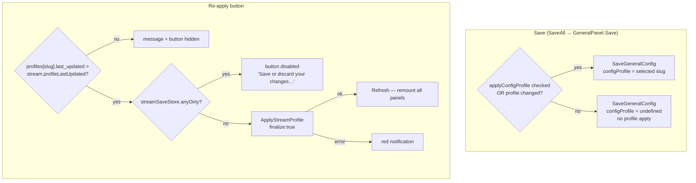
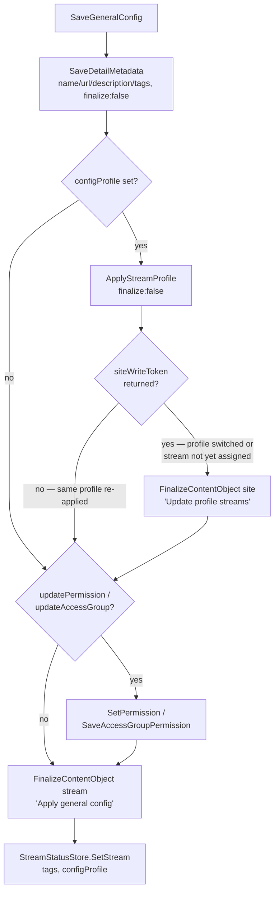

# Profile apply flow

Applying a profile to a stream is driven by `StreamEditStore.ApplyStreamProfile`, reached two ways from the General panel: the panel's Save (`SaveGeneralConfig`) and the "Re-apply" button. Both call the fabric-js `StreamApplyProfile`, which rewrites `live_recording_config` from the profile and regenerates `live_recording` via `StreamConfig` when probe data exists.

## Entry points (General panel)



- Switching to a different profile requires the "Apply profile settings…" checkbox (form validation). Checking it on the **current** profile re-applies that profile on Save.
- The "Profile has been changed." message compares the profile's `last_updated` with the stream's `public/asset_metadata/profile_last_updated`, which `StreamDetailStore.LoadGeneralConfigData` loads into `streams[slug].profileLastUpdated`. `StreamApplyProfile` stamps a new `profile_last_updated`, so a successful apply hides the message.
- Re-apply commits on its own and then remounts every panel, so it's blocked while any tab is dirty rather than silently discarding edits.

## `ApplyStreamProfile`

```mermaid
sequenceDiagram
    participant Caller as SaveGeneralConfig / Re-apply
    participant StreamEditStore
    participant ProfileStore
    participant FrameClient

    Caller->>StreamEditStore: ApplyStreamProfile(objectId, writeToken?, profileSlug, finalize)
    StreamEditStore->>ProfileStore: profiles[profileSlug]
    StreamEditStore->>FrameClient: read live_recording_config<br/>{ingress_node_id, geo, name}
    opt slugify(current name) === profileSlug
        StreamEditStore->>FrameClient: read site profile_streams/<profileSlug>
        Note right of StreamEditStore: siteUnchanged = stream already listed<br/>(StreamAssignProfile will be a no-op)
    end
    StreamEditStore->>FrameClient: StreamApplyProfile({...profile, ingress_node_id?, geo?},<br/>objectId, streamWriteToken, finalize:false)
    Note over FrameClient: keeps only url/name/probe_info/input_stream_info<br/>from the old config — node fields are re-added by the<br/>app so StreamConfig resolves the node by id, not URL host.<br/>Resets live_recording / overrides, runs StreamConfig if probed,<br/>stamps profile_last_updated, (un)assigns on site token
    FrameClient-->>StreamEditStore: {streamWriteToken, siteWriteToken}

    alt probeCleared is falsy (always, on client-js 4.2.46)
        StreamEditStore->>StreamEditStore: SaveStreamAudioSettings(finalize:false)
        Note right of StreamEditStore: resyncs recording_stream_config/audio<br/>and ladder specs to what was probed
    else probeCleared is true
        Note right of StreamEditStore: skip resync
    end

    opt finalize (default true; Re-apply button)
        StreamEditStore->>FrameClient: FinalizeContentObject(stream, "Apply stream profile")
        opt siteWriteToken AND NOT siteUnchanged
            StreamEditStore->>FrameClient: FinalizeContentObject(site, "Apply stream profile")
        end
    end
    StreamEditStore-->>Caller: response (siteWriteToken dropped when siteUnchanged)
```

`siteUnchanged` exists because `StreamApplyProfile` always opens a site write token, but re-applying the stream's current profile writes nothing to it — finalizing it would produce an empty site commit. The token is left unfinalized.

## Caller: `SaveGeneralConfig` (General panel Save)

`ApplyStreamProfile` is called with `finalize: false` here, so the outer method controls the single combined commit.



`probeCleared` only drives the audio-resync branch inside `ApplyStreamProfile`; `SaveGeneralConfig` doesn't surface it, so the UI shows no signal when a profile apply clears probe data.

## `ProfileStore` — where profiles come from

- `LoadProfiles()` — `client.StreamConfigProfiles({resolveLinks: true})` populates `profiles` (slug → profile, read-only "original") and seeds `drafts` (editable copies) as a shallow copy. Loaded once per session on the details page.
- `SaveProfiles()` writes each dirty draft via `client.StreamSaveConfigProfile`. It stamps `draft.last_updated` locally first — the SDK stamps its own copy on the Core side of FrameClient, so without this the in-session `profiles[slug].last_updated` would stay stale and the "Profile has been changed." message wouldn't appear until reload. On rename, it also migrates `public/asset_metadata/profile_streams/<oldSlug>` → `<newSlug>` on the site object — this is the `stream_profiles` mapping referenced in CLAUDE.md, and it must move atomically with the profile rename.
- `DeleteProfile(slug)` deletes both the `live_stream_profiles/<slug>.json` file and the `public/asset_metadata/profiles/<slug>` metadata.

`ApplyStreamProfile`'s `siteWriteToken` finalize step corresponds to `StreamApplyProfile` itself updating this same site-object profile↔stream bookkeeping fabric-side.

## Key files

- `src/stores/streams/StreamEditStore.ts` — `ApplyStreamProfile`
- `src/stores/streams/StreamEditStore.ts` — `SaveGeneralConfig` (Save caller)
- `src/stores/streams/StreamEditStore.ts` — `SaveStreamAudioSettings` fallback branch (reconstructs audio index from ladder specs when no probe data exists yet)
- `src/stores/streams/StreamDetailStore.ts` — `LoadGeneralConfigData` (loads `profileLastUpdated`)
- `src/pages/streams/details/general/GeneralPanel.jsx` — `Save()` (checkbox → `configProfile`), Re-apply button
- `src/stores/ProfileStore.ts` — `LoadProfiles`
- `src/stores/ProfileStore.ts` — `SaveProfiles` (local `last_updated` stamp, rename migration of `profile_streams`)
- `src/stores/ProfileStore.ts` — `DeleteProfile`
